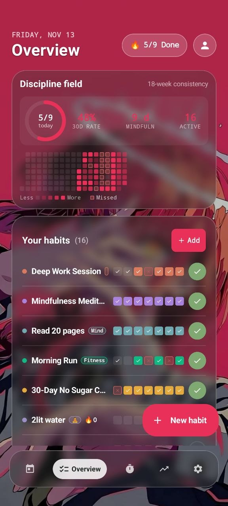
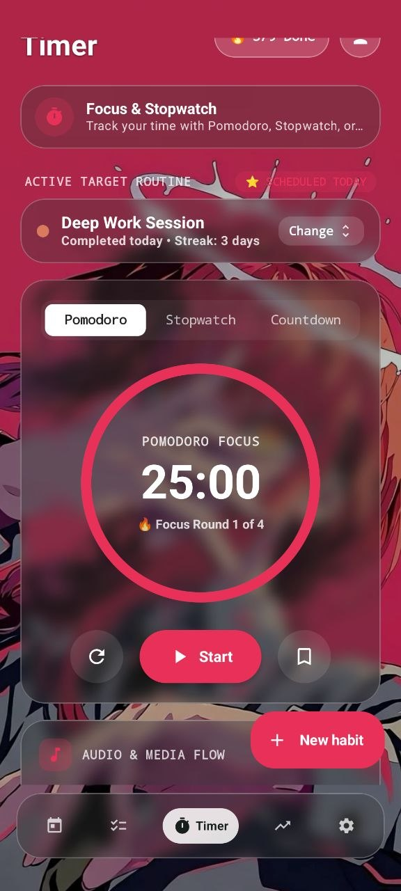
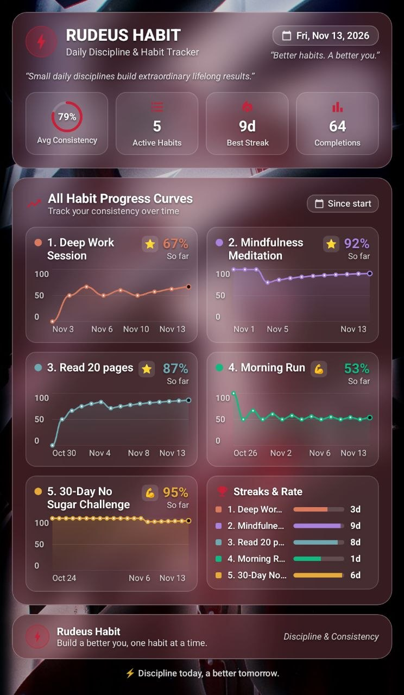
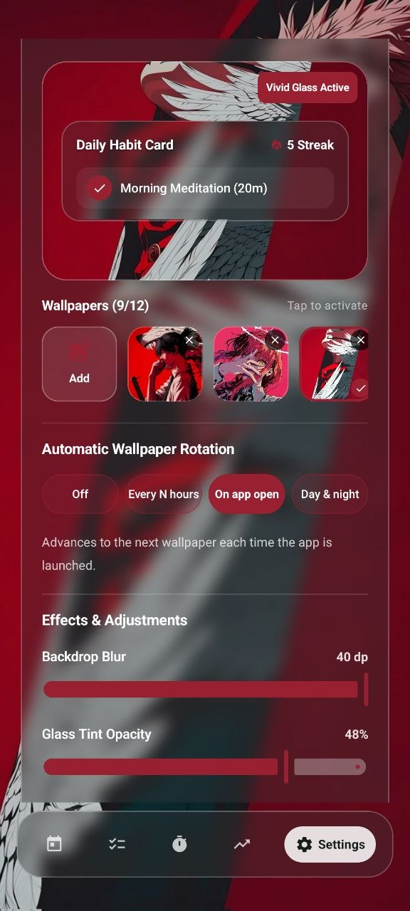
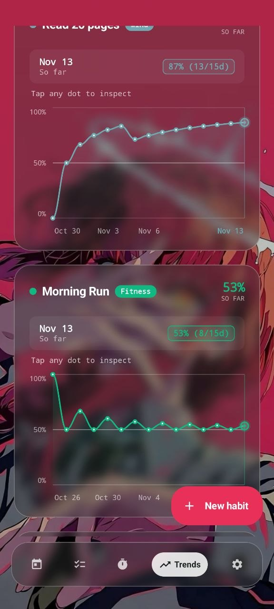
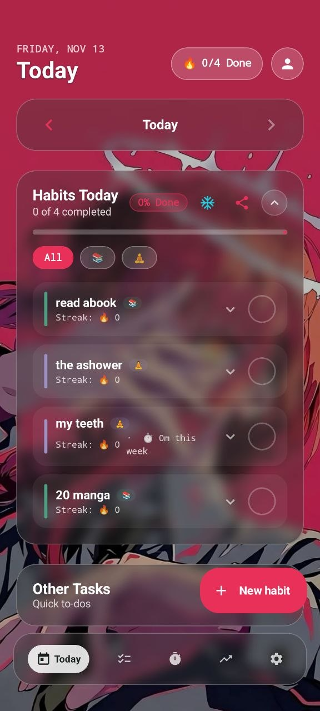
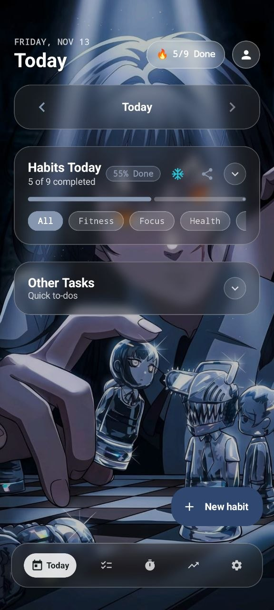
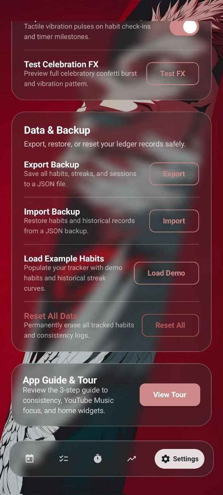
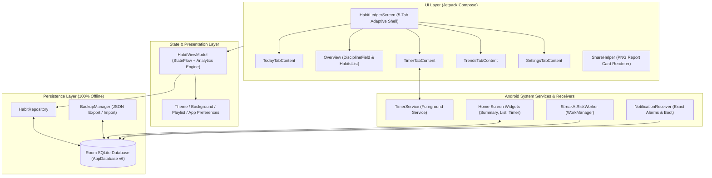

<div align="center">

# ⚡ Rudeus Habit — Remix Habit Tracker Pro

**An offline-first, glassmorphic Android habit ledger, focus timer, and analytics suite built with Kotlin & Jetpack Compose.**

[](https://github.com/redeus12/rudeus-habit-tracker-pro/actions/workflows/release-apk.yml)
[](https://github.com/redeus12/rudeus-habit-tracker-pro/releases/latest)
[-3DDC84?style=for-the-badge&logo=android&logoColor=white)](https://github.com/redeus12/rudeus-habit-tracker-pro/releases/latest)
[](https://kotlinlang.org/)
[](https://developer.android.com/jetpack/compose)

[**📥 Download Latest APK (`v1.0.0`)**](https://github.com/redeus12/rudeus-habit-tracker-pro/releases/download/v1.0.0/RudeusHabit-v1.0.0.apk) · [**📸 Screenshots**](#-screenshots) · [**✨ Features**](#-overview--key-features) · [**🏗️ Architecture**](#-tech-stack--architecture) · [**🛠️ Build from Source**](#-local-development--building-from-source)

<br/>

<p align="center">
  
  
  
  
</p>

</div>

---

## 📸 Screenshots

### Core Tracking, Focus Timer & Analytics

| 18-Week Discipline Field | Pomodoro & Stopwatch Timer | Interactive Trend Curves | Exported Progress Share Card |
| :---: | :---: | :---: | :---: |
| <br/>**Overview & Heatmap**<br/>*18-week consistency grid, 30-day rate & weekly habit matrix* | <br/>**Focus & Stopwatch**<br/>*Pomodoro rounds, Stopwatch, Countdown & media flow* | <br/>**Trends & Inspection**<br/>*Tap any dot to inspect historical completion rates* | <br/>**Studio Share Card**<br/>*High-res summary card with all habit curves & streaks* |

### Glassmorphic Wallpaper Engine, Daily Checklist & Offline Backup

| Vivid Glass & Wallpaper Engine | Today Habits & Subtasks | Dynamic Glass Theme Adaptation | Offline JSON Backup & FX |
| :---: | :---: | :---: | :---: |
| <br/>**Vivid Glass Engine**<br/>*Up to 12 custom wallpapers, auto-rotation, blur & tint sliders* | <br/>**Today Checklist**<br/>*Category filters, streak counters, freeze shield & quick to-dos* | <br/>**Adaptive Glass Palette**<br/>*Automatic accent & frosted card tinting per wallpaper* | <br/>**Data & Celebration FX**<br/>*100% offline JSON export/import, demo loader & haptics* |

---

## ✨ Overview & Key Features

**Rudeus Habit (Remix Habit Tracker Pro)** is a native Android application designed to help you build lasting routines, track deep focus sessions, and visualize long-term consistency—all with **100% on-device privacy** and zero cloud lock-in.

### 🗓️ 1. Flexible Habit Ledger & Streak Protection
- **Custom Weekly Schedules**: Schedule habits on specific days of the week (`Sun`–`Sat`) with built-in rest days that never penalize your streak.
- **Goal Challenges & Ongoing Routines**: Define fixed-horizon challenges (e.g., 21-day, 30-day, or 90-day sprints) or open-ended daily habits.
- **Daily Subtasks & Quick Tasks**: Break complex habits down into checkable daily subtasks (`HabitSubtask`) alongside a standalone quick-task checklist (`Other Tasks`).
- **Streak Freeze Shield (`❄️`)**: Protect unbroken streaks on sick days, travel days, or emergencies using the built-in Streak Freeze ledger (`HabitFreezeEntity`).

### 📊 2. 18-Week Discipline Field & Deep Analytics
- **126-Day Consistency Heatmap**: Visualize 18 weeks of daily execution intensity (`DisciplineFieldCard`) with clear indicators for completed, scheduled, missed, and frozen days.
- **Multi-Granularity Trend Curves**: Analyze completion rates across **Daily**, **Weekly**, and **Monthly** chart buckets (`TrendsTabContent`) with interactive dot inspection.
- **Category Performance Breakdown**: Filter and compare completion percentages across custom categories (`Fitness`, `Focus`, `Health`, `Mind`, etc.).

### ⏱️ 3. Decoupled Focus Timer & Media Control
- **Three Precision Timer Modes**: Run **Pomodoro** (25-minute focus intervals with automatic break rounds), **Stopwatch** (count-up time logging), or **Countdown** (custom target duration) via a persistent Android Foreground Service (`TimerService`).
- **Integrated & External Audio Control**: Play built-in/custom focus tracks (`PlaylistPreferences`) or control external media apps (**Spotify**, **YouTube Music**, etc.) with in-app track skipping and volume tuning (`MediaControlHelper`).
- **Automatic Time Ledger**: Every focus session is automatically recorded (`TimeSessionEntity`) and aggregated into weekly time-spent totals per habit.

### 📱 4. Interactive Android Home Screen Widgets
- **4×2 / 4×4 Habit List Widget (`HabitListWidgetProvider`)**: View today's scheduled habits and toggle completions directly from your home screen.
- **2×2 Summary Widget (`HabitSummaryWidgetProvider`)**: Track daily completion percentage and active habit counts at a glance.
- **Timer Control Widget (`TimerWidgetProvider`)**: Start, pause, and monitor your active focus stopwatch or Pomodoro session from the launcher.

### 🎨 5. Vivid Glassmorphism & Dynamic Wallpaper Engine
- **Real-Time Frosted Glass UI**: Custom StackBlur wallpaper pipeline (`FastStackBlur`, `WallpaperBlurHelper`) with live sliders for **Backdrop Blur (`0–40 dp`)** and **Glass Tint Opacity** (`GlassComponents`).
- **Automated Wallpaper Rotation**: Manage up to 12 custom wallpapers and rotate them **Every N hours**, **On app open**, or on a **Day & night** schedule (`BackgroundPreferences`).
- **Tactile Feedback & Celebrations**: Custom completion audio (`SoundPool` + user-selectable sound files), waveform haptic feedback (`AppFeedbackHelper`), and a particle confetti overlay (`ConfettiOverlay`).

### 🖼️ 6. Studio-Quality Shareable Report Cards & JSON Backup
- **High-Res PNG Share Cards (`ShareHelper`)**: Generate and share customizable image cards for your **Daily Report** (`DayReportShareCard`), **Single Habit Milestone Curve** (`SingleHabitShareCard`), or **All-Habits Progress Ledger** (`AllHabitsShareCard`).
- **100% Offline JSON Export/Import (`BackupManager`)**: Back up and restore your entire database (habits, completions, time sessions, subtasks, and tasks) to a portable `.json` file anytime.

---

## 📥 Download & Installation

Pre-built Android `.apk` packages are automatically compiled and published via GitHub Actions on every release.

1. Go to the [**Releases**](https://github.com/redeus12/rudeus-habit-tracker-pro/releases/latest) page or click [**Direct APK Download (`RudeusHabit-v1.0.0.apk`)**](https://github.com/redeus12/rudeus-habit-tracker-pro/releases/download/v1.0.0/RudeusHabit-v1.0.0.apk).
2. Open the downloaded `.apk` file on your Android phone or tablet (Android 7.0 Nougat / API 24 or newer).
3. If prompted by Android, allow **"Install unknown apps"** for your browser or file manager, then tap **Install**.

---

## 🏗️ Tech Stack & Architecture

| Layer | Technology | Purpose |
| :--- | :--- | :--- |
| **Language** | Kotlin `2.2.10` + Coroutines / `StateFlow` | Reactive state management & background concurrency |
| **UI Framework** | Jetpack Compose + Material 3 + Vivid Glass Engine | Declarative 5-tab UI, adaptive phone/tablet layout, frosted glass rendering |
| **Local Database** | AndroidX Room `2.7.0` (SQLite, Schema v6) | Relational persistence for habits, completions, freezes, subtasks, tasks, & time sessions |
| **Background Work** | Foreground Service (`TimerService`) + WorkManager (`StreakAtRiskWorker`) | Persistent stopwatch/Pomodoro timer & daily 8:00 PM streak-at-risk reminders |
| **Home Widgets** | Android `AppWidgetProvider` + `AlarmManager` | 3 home-screen widgets with midnight auto-refresh (`WidgetUpdateReceiver`) |
| **Image & Visuals** | Coil Compose `2.7.0` + AndroidX Palette + Custom Canvas | Wallpaper loading, color extraction, heatmaps, trend charts, & offscreen PNG card rendering |
| **Testing** | JUnit 4, Robolectric `4.16.1`, Roborazzi `1.59.0` | Unit tests for streak math, database migrations, wallpaper rotation, & share card rendering |

### Architecture Diagram



---

## 🛠️ Local Development & Building from Source

### Prerequisites
- **Android Studio** (Otter / Meerkat or newer) or **Android SDK Command-Line Tools** (API 36)
- **JDK 17 or JDK 21**
- **Gradle 9.3.1+** (automatically bootstrapped via `./gradlew`)

### 1. Clone the Repository
```bash
git clone https://github.com/redeus12/rudeus-habit-tracker-pro.git
cd rudeus-habit-tracker-pro
```

### 2. Configure Environment File
```bash
cp .env.example .env
```

### 3. Build the Debug APK via CLI
```bash
# Linux / macOS
chmod +x ./gradlew
./gradlew assembleDebug

# Windows (PowerShell)
.\gradlew.bat assembleDebug
```
The compiled APK will be generated at:
```text
app/build/outputs/apk/debug/app-debug.apk
```

### 4. Run Unit Tests
```bash
./gradlew testDebugUnitTest
```

---

## 📄 License

Distributed under the MIT License.
