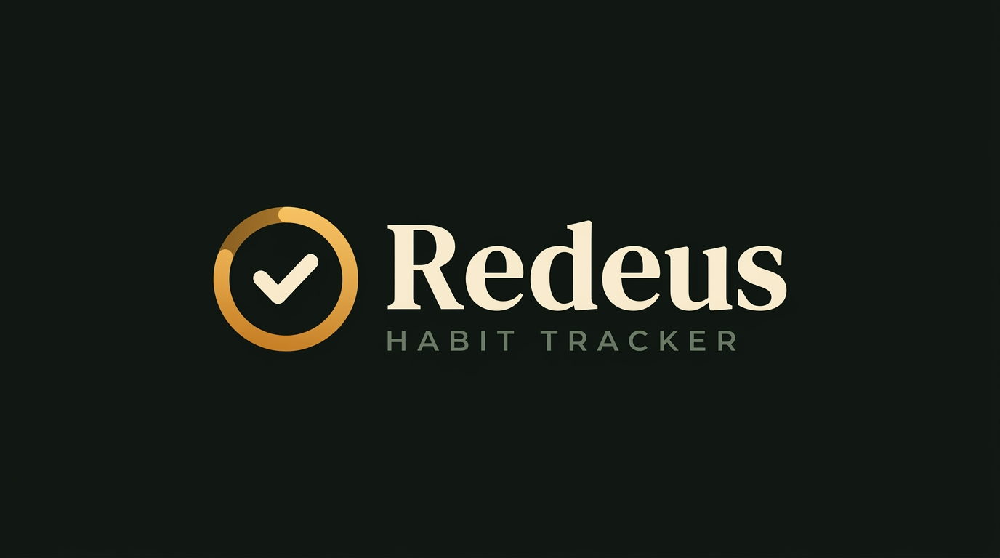
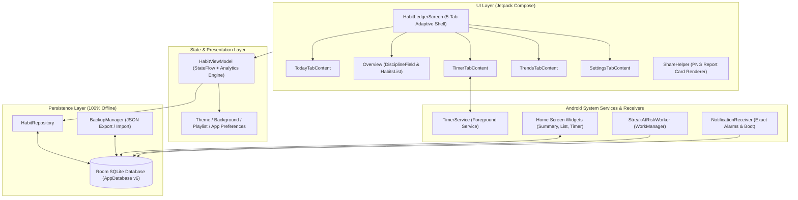

<div align="center">



# Rudeus Habit — Remix Habit Tracker Pro

**An offline-first, glassmorphic Android habit ledger, focus timer, and analytics suite built with Kotlin & Jetpack Compose.**

[](../../actions/workflows/release-apk.yml)
[-3DDC84?style=for-the-badge&logo=android&logoColor=white)](../../releases/latest)
[](https://kotlinlang.org/)
[](https://developer.android.com/jetpack/compose)
[](LICENSE)

[**Download Latest APK**](../../releases/latest) · [**Explore Features**](#-overview--key-features) · [**Architecture**](#-tech-stack--architecture) · [**Build from Source**](#-local-development--building-from-source)

</div>

---

## ✨ Overview & Key Features

**Rudeus Habit (Remix Habit Tracker Pro)** is a native Android application designed to help you build lasting routines, track deep focus sessions, and visualize long-term consistency—all with **100% on-device privacy** and zero cloud lock-in.

### 🗓️ 1. Flexible Habit Ledger & Streak Protection
- **Custom Weekly Schedules**: Schedule habits on specific days of the week (`Sun`–`Sat`) with built-in rest days that never penalize your streak.
- **Goal Challenges & Ongoing Routines**: Define fixed-horizon challenges (e.g., 21-day, 30-day, or 90-day sprints) or open-ended daily habits.
- **Daily Subtasks & Quick Tasks**: Break complex habits down into checkable daily subtasks (`HabitSubtask`) alongside a standalone quick-task checklist.
- **Streak Freeze Shield**: Protect unbroken streaks on sick days, travel days, or emergencies using the built-in Streak Freeze ledger (`HabitFreezeEntity`).

### 📊 2. 18-Week Discipline Field & Deep Analytics
- **126-Day Consistency Heatmap**: Visualize 18 weeks of daily execution intensity (`DisciplineFieldCard`) with clear indicators for completed, scheduled, missed, and frozen days.
- **Multi-Granularity Trend Curves**: Analyze completion rates across **Daily**, **Weekly**, and **Monthly** chart buckets (`TrendsTabContent`).
- **Category Performance Breakdown**: Compare completion percentages across custom categories and color palettes (`CategoryPerformanceCard`).

### ⏱️ 3. Decoupled Focus Timer & Media Control
- **Three Precision Timer Modes**: Run **Pomodoro** (25-minute focus intervals with automatic break rounds), **Stopwatch** (count-up time logging), or **Countdown** (custom target duration) via a persistent Android Foreground Service (`TimerService`).
- **Integrated & External Audio Control**: Play built-in/custom focus tracks (`PlaylistPreferences`) or control external media apps (**Spotify**, **YouTube Music**, etc.) with in-app track skipping and volume tuning (`MediaControlHelper`).
- **Automatic Time Ledger**: Every focus session is automatically recorded (`TimeSessionEntity`) and aggregated into weekly time-spent totals per habit.

### 📱 4. Interactive Android Home Screen Widgets
- **4×2 / 4×4 Habit List Widget (`HabitListWidgetProvider`)**: View today's scheduled habits and toggle completions directly from your home screen.
- **2×2 Summary Widget (`HabitSummaryWidgetProvider`)**: Track daily completion percentage and active habit counts at a glance.
- **Timer Control Widget (`TimerWidgetProvider`)**: Start, pause, and monitor your active focus stopwatch or Pomodoro session from the launcher.

### 🎨 5. Custom Glassmorphism & Dynamic Wallpaper Engine
- **Real-Time Frosted Glass UI**: Custom StackBlur wallpaper pipeline (`FastStackBlur`, `WallpaperBlurHelper`) with adjustable blur radius, dim overlay, and glass card borders (`GlassComponents`).
- **Automated Wallpaper Rotation**: Rotate custom background wallpapers on a fixed minute interval (`INTERVAL`) or automatic `DAY_NIGHT` schedule (`BackgroundPreferences`).
- **Tactile Feedback & Celebrations**: Custom completion audio (`SoundPool` + user-selectable sound files), waveform haptic feedback (`AppFeedbackHelper`), and a particle confetti overlay (`ConfettiOverlay`).

### 🖼️ 6. Studio-Quality Shareable Report Cards & JSON Backup
- **High-Res PNG Share Cards (`ShareHelper`)**: Generate and share customizable image cards for your **Daily Report** (`DayReportShareCard`), **Single Habit Milestone Curve** (`SingleHabitShareCard`), or **All-Habits Ledger** (`AllHabitsShareCard`).
- **100% Offline JSON Export/Import (`BackupManager`)**: Back up and restore your entire database (habits, completions, time sessions, subtasks, and tasks) to a portable `.json` file anytime.

---

## 📥 Download & Installation

Pre-built Android `.apk` packages are automatically compiled and published via GitHub Actions on every release.

1. Go to the [**Releases**](../../releases/latest) page of this repository.
2. Under **Assets**, download the latest `RudeusHabit-v*.apk` file to your Android device.
3. Open the downloaded `.apk` file on your phone or tablet (Android 7.0 Nougat / API 24 or newer).
4. If prompted by Android, allow **"Install unknown apps"** for your browser or file manager, then tap **Install**.

---

## 🏗️ Tech Stack & Architecture

| Layer | Technology | Purpose |
| :--- | :--- | :--- |
| **Language** | Kotlin `2.2.10` + Coroutines / `StateFlow` | Reactive state management & background concurrency |
| **UI Framework** | Jetpack Compose + Material 3 + Custom Glass Theme | Declarative 5-tab UI, adaptive phone/tablet layout, frosted glass rendering |
| **Local Database** | AndroidX Room `2.7.0` (SQLite, Schema v6) | Relational persistence for habits, completions, freezes, subtasks, tasks, & time sessions |
| **Background Work** | Foreground Service (`TimerService`) + WorkManager (`StreakAtRiskWorker`) | Persistent stopwatch/Pomodoro timer & daily 8:00 PM streak-at-risk reminders |
| **Home Widgets** | Android `AppWidgetProvider` + `AlarmManager` | 3 home-screen widgets with midnight auto-refresh (`WidgetUpdateReceiver`) |
| **Image & Visuals** | Coil Compose `2.7.0` + AndroidX Palette + Custom Canvas | Wallpaper loading, color extraction, heatmaps, trend charts, & offscreen PNG card rendering |
| **Testing** | JUnit 4, Robolectric `4.16.1`, Roborazzi `1.59.0` | Unit tests for streak math, database migrations, wallpaper rotation, & share card rendering |

### Architecture Diagram



---

## 📸 Screenshots

> _Replace the placeholders below with live device screenshots once captured._

| Today & Subtasks | 18-Week Discipline Field | Focus Timer & Audio | Trends & Share Cards |
| :---: | :---: | :---: | :---: |
| <br/>*Daily Checklist & Streaks* | <br/>*126-Day Heatmap* | <br/>*Pomodoro & Media Control* | <br/>*Analytics & PNG Cards* |

---

## 🛠️ Local Development & Building from Source

### Prerequisites
- **Android Studio** (Ladybug / Meerkat or newer) or **Android SDK Command-Line Tools** (API 36)
- **JDK 17 or JDK 21**
- **Gradle 9.1+** (automatically bootstrapped via `./gradlew`)

### 1. Clone the Repository
```bash
git clone https://github.com/<your-username>/<your-repo-name>.git
cd <your-repo-name>
```

### 2. Configure Environment File
The project uses the Secrets Gradle Plugin with `.env.example` as a fallback. Create a local `.env` file (excluded from Git via `.gitignore`):
```bash
cp .env.example .env
```
*(Note: All core habit tracking, analytics, timer, widget, and backup features operate 100% offline on device without requiring any external API key.)*

### 3. Build the Debug APK via CLI
```bash
# Linux / macOS
chmod +x ./gradlew
./gradlew assembleDebug

# Windows (PowerShell)
.\gradlew.bat assembleDebug
```
The compiled APK will be generated at:
```text
app/build/outputs/apk/debug/app-debug.apk
```

### 4. Run Unit Tests
```bash
./gradlew testDebugUnitTest
```

---

## 🚀 Automated GitHub Releases (CI/CD)

This repository includes a pre-configured GitHub Actions workflow at [`.github/workflows/release-apk.yml`](.github/workflows/release-apk.yml) that:
1. Triggers automatically when pushing any version tag matching `v*` (e.g., `v1.0.0`) or manually via **Actions → Build & Release Android APK → Run workflow**.
2. Sets up JDK, Android SDK, and Gradle on `ubuntu-latest`.
3. Compiles the Android package (`./gradlew assembleDebug`) and renames it to `RudeusHabit-<version>.apk`.
4. Publishes a new GitHub Release with auto-generated release notes and attaches the downloadable `.apk`.

---

## 📄 License

Distributed under the MIT License.
